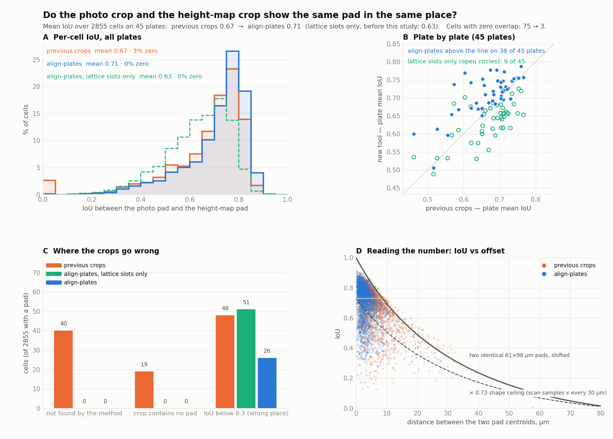
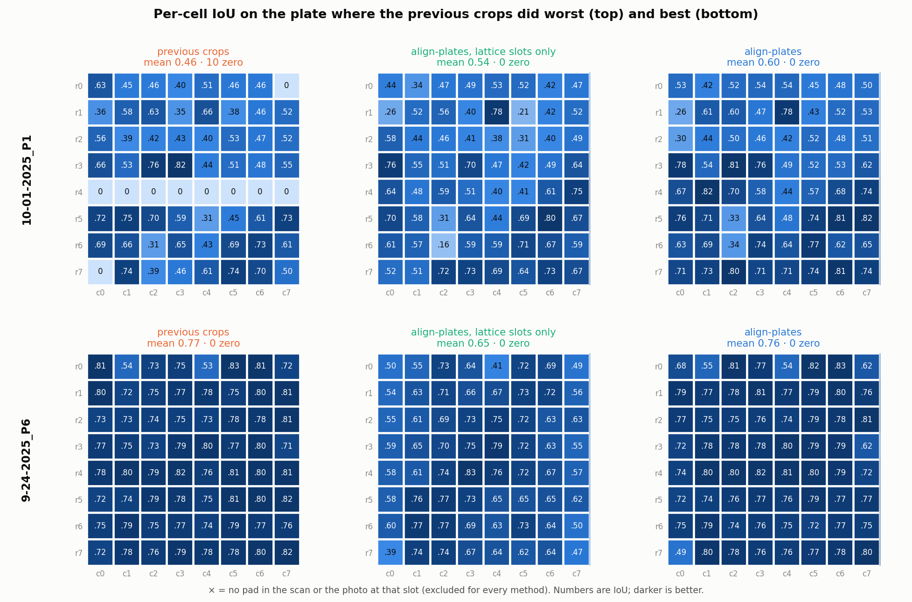
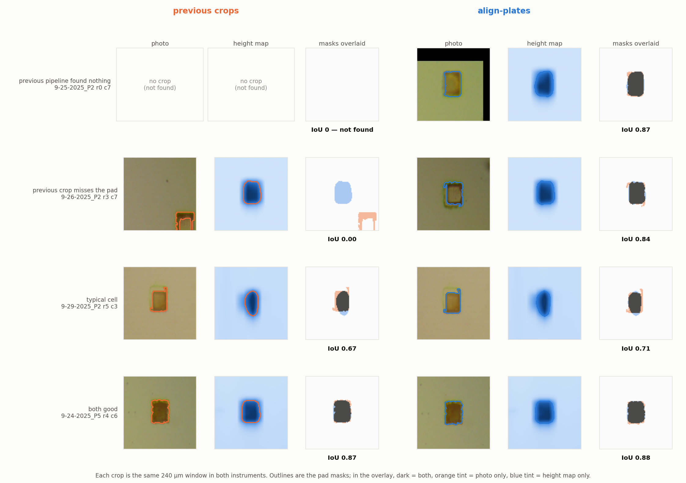

# Is the new alignment objectively better? — IoU of the pad masks

The new `align-plates` crops *look* better than the previous per-cell crops: no
empty rows, no crops of bare silicon. "Looks better" is not a number. This
study scores both with the same metric on the same cells.

Every number below was measured on the **45 plates both pipelines produced a
result for** — the same 45 the earlier model trained on — and is reproducible
with the two scripts at the end.

## Summary

For each cell, take the pad as seen in the photo crop and the pad as seen in
the height-map crop and measure their **intersection-over-union**. If the two
crops are aligned, the two outlines sit on top of each other (IoU → 1); if the
crop is in the wrong place, they do not (IoU → 0).

| | previous crops | `align-plates`, lattice slots (first release, 2026-10-08) | **`align-plates`, detected centres (current)** |
|---|---|---|---|
| mean IoU | 0.669 | 0.634 | **0.709** |
| median IoU | 0.722 | 0.657 | **0.750** |
| cells with zero overlap | 2.6 % (75) | 0.1 % | **0.1 %** |
| cells with IoU < 0.3 (pad in the wrong place) | 3.7 % | 1.8 % | **0.9 %** |
| cells where the method found no pad at all | 59 | 0 | **0** |
| median distance between the two pad centres | 4.4 µm | 7.4 µm | **2.5 µm** |
| plates where this beats the previous crops | — | 9 of 45 | **38 of 45** |
| ceiling (IoU if the centres coincided) | 0.727 | 0.729 | 0.729 |

2,855 cells scored; 25 excluded because no pad exists there in the scan or the
photo (chipped off or never printed — not alignable by anyone).

**Two things happened here, and both matter for the story.**

1. **The first release of `align-plates` was *not* better than the previous
   crops on this metric** (0.634 vs 0.669). It never failed outright — the
   previous pipeline missed the pad completely on 59 cells, the tool on none —
   but it was less precise on the cells both got right, because it cut every
   crop at the position the fitted grid *predicted*, not where the pad actually
   is. Lattice-centred crops sat a median 7.4 µm from the pad against 4.4 µm
   for crops centred on a detected blob.
2. **Fixing that is a one-line change in where the crop is centred**, and it
   is now the tool's default (`--centre detected`; the old behaviour is kept as
   `--centre lattice`). The grid fit still does the job that matters — deciding
   which detection belongs to which slot, rejecting dust, filling in slots with
   no detection — but once that is settled, the detected pad is the better
   centre. With that change the tool beats the previous crops on mean, median,
   failure count and offset, on 38 of 45 plates.

The ceiling is not 1 and that is not an alignment defect; see § 4.



## 1. Why IoU, and how the comparison is kept fair

IoU is the standard way to ask "do these two outlines agree?" — a predicted box
against a ground-truth box, one annotator's label against another's. Here the
two outlines are the same physical pad drawn by two instruments.

The trap in a comparison like this is that the two pipelines produce crops of
different sizes, in different units, with different resampling. Scoring the
crops *as stored* would mostly measure those differences. So everything except
the cell centres is held fixed — a method contributes exactly two numbers per
cell: where it says the cell is in the photo, and where it says it is in the
height map.

| held fixed | value |
|---|---|
| window | 0.9 × fitted pitch ≈ 240 µm square, the same in both instruments |
| grid | 96 × 96 (≈ 2.5 µm / px) |
| photo → µm | the per-plate scale from the registration (≈ 1.07 × 1.46 µm/px) |
| height map | detrended, µm above the substrate plane |
| mask | threshold at half the crop's peak above its background; keep the connected component nearest the crop centre; fill holes |
| pad present? | decided once per cell from the geometry, with a 1.2-pitch search window so a registration error cannot hide a pad |

Where the centres come from:

- **previous crops** — the stored centroids in `data/metadata/img_crop_details.json`
  and `prof_crop_details_v2.json`. These are what produced the earlier training
  set: template-matching the stored crops back into the photos lands on them with
  correlation 0.997–0.999. The height-map ones are in a rotated, resampled space
  of unknown scale (the previous pipeline rotated the scan upright before
  locating pads), so a per-plate six-parameter affine converts them to µm. The
  affine is fit on the matched `(row, col)` pairs with 3-MAD rejection, so the
  cells the previous pipeline got wrong do not bend the conversion for the ones
  it got right. Residual on the kept cells: **median 2.9 µm, max 4.1 µm** over 45
  plates (`results/unit_conversion.csv`); the rejected cells are off by a whole
  pitch (~265 µm).
- **`align-plates`, lattice** — the 8×8 lattice slot in µm and its image under
  the fitted photo→scan affine.
- **`align-plates`, detected** — the detection the lattice solver assigned to
  that slot (an inlier), in each modality independently; the lattice prediction
  where none was assigned. This is `build_cells(centre="detected")`, the
  current default.

A cell with no pad in the scan *or* in the photo is excluded for every method.
A cell a method **failed to find** (the previous pipeline's `found: false`, or
a crop containing no pad) scores 0 — that is a method failure, not a missing
pad.

## 2. Where the previous crops went wrong

Of 2,855 cells, the previous pipeline reported 40 as not found and produced 19
crops with no pad in them; a further 16 crops contain a pad but the wrong one
(IoU < 0.05). The failures cluster: on `10-01-2025_P1` an entire row scores
zero (the previous height-map centroids for row 4 are a whole pitch off), which
is the "empty row" visible in the old montage.





The new tool has no cells in the first two categories. Its 0.9 % below 0.3 are
genuine near-misses on cells where the scan's coarse axis makes the pad's x
position ambiguous (see § 4), not slot errors.

## 3. Why lattice-centred crops lost

The lattice is a rigid 10-parameter model of where the pads *should* be. Its
job is assignment and outlier rejection, and it does that well (study 01). But
the residual between where a pad is and where the model puts it is 2.75 % of
pitch on the height map (≈ 7 µm) and 1.1 % on the photo (≈ 3 px), and the
cross-modal registration adds 8 µm. A crop centred on the prediction inherits
all of that; a crop centred on the detection inherits only detection noise.

For a pad ≈ 61 × 98 µm, a 7 µm offset costs roughly 0.1 in IoU (panel D of the
summary figure gives the curve). That is the whole gap between 0.634 and 0.709.

## 4. Why the ceiling is ≈ 0.73, not 1

Even perfectly centred, the two masks do not coincide, because the two
instruments draw the pad differently:

- the stylus samples the scan every **30 µm along x** (2.9 µm along y), so a
  61 µm-wide pad is two or three samples wide and its mask edge is smeared by
  interpolation; the photo resolves the same edge at 1.25 µm;
- the two instruments disagree about the grid's aspect ratio by ≈ 4:3 (the
  open calibration question from study 01), which stretches one mask relative
  to the other.

Sliding the masks so their centroids coincide gives the *ceiling* column in the
table — the best any alignment could do on this data. The current tool sits at
**97 %** of it (mean IoU / ceiling); the previous crops at 92 % counting their
59 failures as zero (94 % on the cells they did find); the lattice release at
87 %. The remaining 3 % is detection noise on the scan's coarse axis and is not
recoverable from these instruments.

So "IoU 0.71" should be read as "essentially at the ceiling", not as "71 %
aligned". When the lab moves to the 10× all-in-focus images and a finer scan,
the ceiling rises and this metric will show it.

## 5. What this does and does not claim

- It **does** show the new crops put the photo pad and the height-map pad in
  the same place more consistently than the previous crops, with no outright
  failures, on the identical set of cells, under an identical recipe.
- It **does not** say anything about whether the heights can be predicted from
  the photos; that is studies 01 and 02.
- The unit conversion for the previous height-map centroids leans on the new
  pipeline's detections. It is a 6-parameter fit over ~60 points per plate with
  a 3 µm residual, so it cannot move a cell by more than a few µm — but it
  means the previous pipeline is scored in the new pipeline's frame. Scoring it
  in its own frame would need its resampled scans, which were not kept.

## Files

```
results/cells.csv            one row per cell per method: status, IoU, ceiling, centre offset
results/plates.csv           one row per plate per method
results/summary.csv          the table above
results/unit_conversion.csv  the previous-pipeline → µm affine per plate, with residual
figures/iou_summary.png      distribution · plate-by-plate · failure counts · IoU vs offset
figures/iou_examples.png     the same cells under both methods, masks drawn
figures/iou_plate_grid.png   per-cell IoU on the worst and best plate for the previous crops
figures/iou_comparison_simple.png   the one-slide version for a non-specialist audience
iou.ipynb                    the same, as a runnable notebook
src/iou_lib.py               the shared recipe (window, mask, IoU, unit conversion)
src/compute_iou.py           runs it over the 45 plates → results/
src/make_figures.py          results/ → figures/
src/make_simple_figure.py    results/ → figures/iou_comparison_simple.png
src/make_notebook.py         regenerates iou.ipynb (--write)
```

## Reproduce

```bash
MPLBACKEND=Agg uv run python studies/03-alignment-iou/src/compute_iou.py      # ~2.5 min
MPLBACKEND=Agg uv run python studies/03-alignment-iou/src/make_figures.py
MPLBACKEND=Agg uv run python studies/03-alignment-iou/src/make_simple_figure.py
uv run python studies/03-alignment-iou/src/make_notebook.py --write
uv run python -m nbconvert --to notebook --execute --inplace studies/03-alignment-iou/iou.ipynb
```
