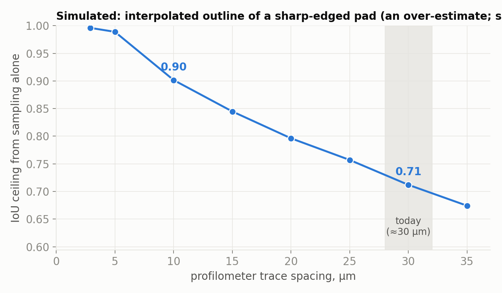

# Instrument checks: the three open issues from the midterm

The midterm listed three issues. This study works through each as far as the
data allow. Numbers are measured on the 69 plates in `data/` and reproducible
with the scripts at the end.

| Issue | What the data say | Status |
|---|---|---|
| **1. Photo and scan disagree on the grid's shape (≈4:3)** | The camera is consistent to 0.1–0.3% across plates; the scan's axis scales vary ±3% plate to plate. The fixed 1.32× offset between the two cannot be settled from these instruments alone. It does **not** affect alignment or IoU. | Narrowed to **one question for the lab**; the tool switches with one flag (`--photo-crop`) once it's answered |
| **2. The coarse scan traces** *(corrected 2026-10-31)* | A pad that sits on a trace comes out about a third too narrow in the height map (IoU 0.58 vs 0.75). The traces also limit how precisely the scan places a pad across them (4.6 vs 3.5 µm per pad). | **Outline fixed in software** (study 05: scan rebuilt from its traces); finer traces would help the across-trace precision |
| **3. New input: larger all-in-focus images** | Detection already gives the same fit on a 2.7× larger image; it was 7× slower, now ≈3.7×. 16-bit and float files are now read correctly. | **Fixed** as far as possible without real all-in-focus images |

## 1. The ≈ 4:3 disagreement

The registration finds that one photo pixel spans **1.09 µm along x but
1.44 µm along y** in the scan's units, while the optics (2.5 µm sensor pixels
behind 4× and 0.5×) say pixels should be square at 1.25 µm. Put another way,
the grid is 1.37× wider than tall in the photo but 1.04× in the scan.

```
                                       median    10th – 90th percentile
grid aspect (col / row pitch), photo    1.368      1.363 – 1.374
grid aspect (col / row pitch), scan     1.039      0.956 – 1.132
disagreement                            1.318      1.211 – 1.429
photo µm per px (registration), x       1.090
photo µm per px (registration), y       1.435
geometric mean                          1.251      (optics predict 1.25)
```

### What is settled

- **The camera is consistent.** Its grid spacing varies 0.14% (columns) and
  0.33% (rows) across 69 plates. The pads are printed from a fixed pattern, so
  this is what a stable instrument should show.
- **The scan is not.** Its grid spacing varies 3.1% per axis from plate to plate,
  and the two axes move in opposite directions (r = −0.92): when columns read
  long, rows read short. The grid's apparent shape tracks the x step recorded
  in each file (r = 0.80), and the recorded steps themselves vary (trace
  spacing 28.1–32.0 µm, along-trace step 2.71–2.96 µm). Counted in samples
  rather than µm, the variation shrinks to about 2% but does not vanish.
  So a µm value read from a single scan is good to roughly ±3% per axis.
- **None of this affects the alignment or the IoU.** Each plate is registered
  with its own six-parameter affine, which absorbs whatever scale each axis
  has on that plate. IoU is unchanged when both outlines are stretched by the
  same affine. The disagreement matters only for absolute sizes in µm.

### What is not settled, and why the data cannot settle it

Two explanations fit every number above equally well:

| | H1: the camera is right | H2: the scan is right |
|---|---|---|
| what is wrong | profilometer's axis scales (x reads 0.87×, y 1.15×) | photo was resampled on export (pixels not square) |
| physical grid pitch | **312 × 228 µm** (grid ≈ 4:3) | **272 × 262 µm** (grid ≈ square) |
| physical pad size | **≈ 60 × 62 µm** (square) | **≈ 53 × 70 µm** (taller than wide) |

Any comparison between the two instruments comes out the same under both,
because H1 and H2 differ by exactly the affine the registration already fits.
Only an **outside reference** can decide.

### The question for the lab (either one settles it)

1. **What pad size and pitch, in µm, does the printing pattern specify?** If
   the design is about 60 µm square pads at 312 × 228 µm pitch, the camera is
   right. If it is about 270 µm pitch both ways, the scan is right and the camera
   software is resampling on export.
2. **Photograph a stage micrometer** (calibration slide) with the same camera,
   objective and export settings. If 100 µm spans 80 px both horizontally and
   vertically, the camera's pixels are square at 1.25 µm (H1).

### What the tool does meanwhile

`align-plates` crops the photo **square in camera pixels** by default
(`--photo-crop sensor`), which is right under H1. Under H2, use
`--photo-crop scan`, which crops square in the scan's micrometres. Both scales
are stored in every plate's `.npz` (`um_per_px`), so earlier outputs can be
corrected without re-running.

## 2. The coarse scan traces

> **Corrected 2026-10-31.** This section first said that trace spacing alone
> caps IoU at 0.71 and that 10 µm traces would allow ≈ 0.90. A follow-up then
> said the traces were not the main cause. Both were wrong; study 05 has the
> evidence and the fix. Summary below.

The stylus records a trace every ≈ 30 µm across the pads and every 2.9 µm along
them; a pad is ≈ 53 µm wide.

**Where it actually bites.** Per-edge averages make the traces look harmless:
over all cells, the outlines' left/right edges (across traces) disagree by
4.0–4.1 µm and their top/bottom edges (along traces) by 3.8–4.3 µm
(`src/edge_check.py`, `results/edge_disagreement.csv`). But the average hides a
dependence on where each pad sits between traces. A pad centred *on* a trace has
only that trace across its flat top; linear interpolation turns the top into a
triangle and the height-map outline comes out about a third too narrow:

| where the pad centre sits | cells | scan ÷ photo width | mean IoU |
|---|---|---|---|
| on a trace | 327 | 0.67 | 0.58 |
| halfway between traces | 1,633 | 1.02 | 0.75 |

Most pads sit near halfway, which is why the averages looked fine.

**Fixed in software.** Study 05 rebuilds each pad from its traces, using a
width and edge softness fitted per plate from all its pads (scan data only; the
fitted width, 52.4 µm, matches the photo's 52.8 µm without consulting it). The
rebuilt width no longer depends on where the traces fell, and pads sitting on a
trace go from IoU 0.58 to 0.78.

**What remains a hardware limit.** The traces also limit how precisely the
scan can place a pad *across* them: after removing the stage's per-column
shifts, the per-pad photo-vs-scan pairing error is 4.6 µm across traces against
3.5 µm along them (study 05, section 6). A finer trace spacing for training
plates would narrow that gap; it is no longer needed to fix the outline.

**The original simulation**, kept for the record (`src/sampling_ceiling.py`,
`results/sampling_ceiling.csv`), samples sharp photo outlines at a given trace
spacing and rebuilds them *by interpolation*. It is an over-estimate of the
cost, because interpolation is the step study 05 replaces:

| trace spacing | IoU of an interpolated sharp-edged outline |
|---|---|
| 10 µm | 0.902 |
| 30 µm (today) | 0.712 |



## 3. Larger, all-in-focus images

The planned setup (1-inch sensor, 10× objective, 0.5× demag) will image the
same plate at roughly 2.7× today's pixel count per side, and focus-stacking
software usually writes 16-bit or floating-point files. No such images exist
yet, so `resolution_check.py` enlarges two of today's photos to 5468 × 4101 and
runs detection on them.

| plate | size | pads on the grid | residual (% of pitch) | time |
|---|---|---|---|---|
| 10-01-2025_P1 | 2048 × 1536 | 62 / 64 | 1.42 | 3.0 s |
| 10-01-2025_P1 | 5468 × 4101 | 62 / 64 | 1.42 | 11.3 s |
| 9-24-2025_P6 | 2048 × 1536 | 62 / 64 | 1.01 | 3.0 s |
| 9-24-2025_P6 | 5468 × 4101 | 63 / 64 | 1.05 | 11.1 s |

Before this change the large images also aligned (62–64 pads), but took
22.5 s, 12.6 s of it in the illumination blur. Two changes in
`src/Auto_OPDx/alignment/rgb.py`:

- **The illumination blur scales with the image** and is computed on a copy
  shrunk to the reference size, then enlarged again. A larger image of the same
  field now gives the same response as today's image (and the same fit, as the
  table shows) at a fraction of the cost. Images up to 2048 px take exactly the
  old code path, so results on today's 69 plates are unchanged.
- **16-bit and floating-point files are read correctly.** They are scaled to
  8 bits by their own 99.9th percentile rather than by the type's maximum, so a
  12-bit image stored in 16 bits keeps its contrast. Greyscale and alpha are
  handled. 8-bit files take the old path unchanged.

Eight new tests (`tests/test_rgb.py`) cover the loader, the unchanged
reference path and detection at two resolutions.

**Still open:** a real all-in-focus image may differ from an enlarged photo in
contrast and texture, not just size. The first composite from Wayne's setup is
the test that matters.

## Files

```
src/check_calibration.py     issue 1: per-plate grid shape, scales, pad sizes, H1/H2 predictions
src/sampling_ceiling.py      issue 2: simulated IoU of an interpolated outline vs trace spacing (over-estimate)
src/edge_check.py            issue 2: where the two outlines disagree, edge by edge
src/resolution_check.py      issue 3: detection on 2.7x enlarged photos
results/calibration.csv      one row per plate (69)
results/sampling_ceiling.csv
results/edge_disagreement.csv
results/resolution_check.csv
figures/sampling_ceiling.png
```

## Reproduce

```bash
MPLBACKEND=Agg uv run python studies/04-instrument-checks/src/check_calibration.py    # ~4 min
MPLBACKEND=Agg uv run python studies/04-instrument-checks/src/sampling_ceiling.py     # ~1 min
MPLBACKEND=Agg uv run python studies/04-instrument-checks/src/edge_check.py           # ~3 min
MPLBACKEND=Agg uv run python studies/04-instrument-checks/src/resolution_check.py     # ~30 s
```
