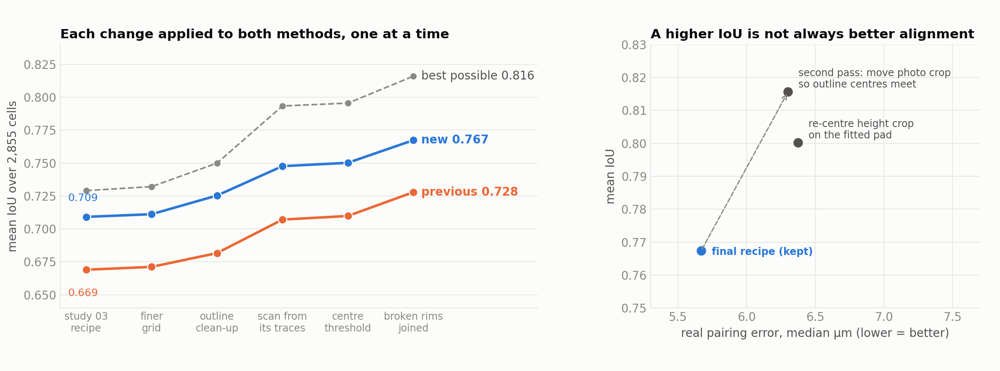
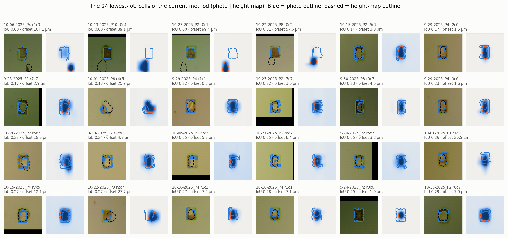
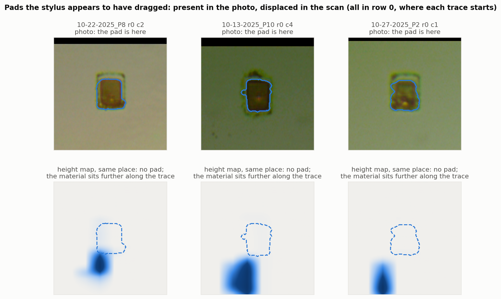
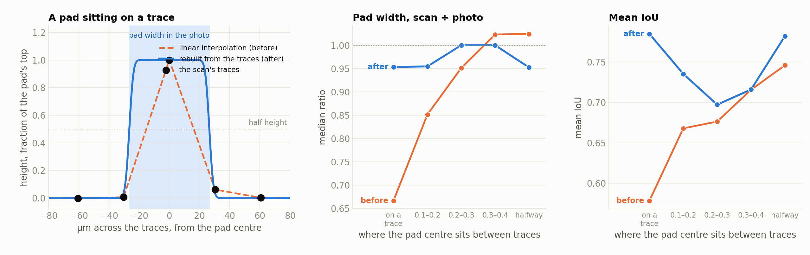
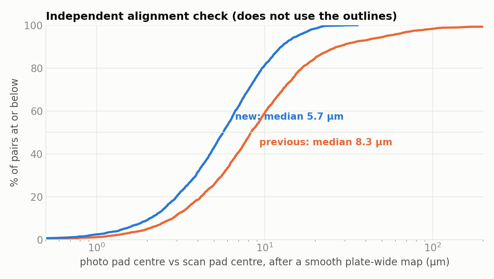
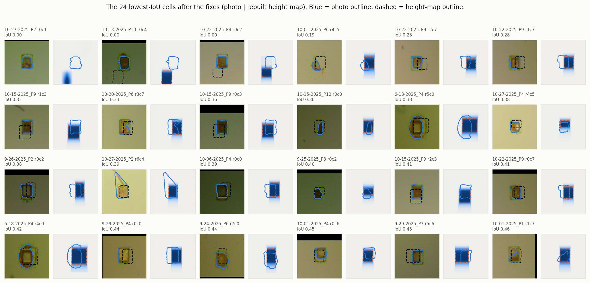
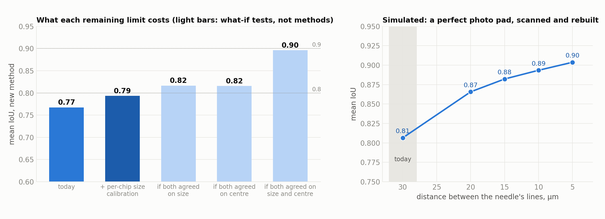

# Getting the IoU closer to 1

Study 03 scored the alignment with the IoU of each cell's pad outlines (photo vs.
height map) and found the new method ahead, 0.709 against 0.669. This study asks
what keeps that number well below 1, fixes what can be fixed, and checks that
every gain is real rather than a side effect of how the score is computed.

Every number is measured on the same 2,855 cells on 45 plates as study 03, and
is reproducible with the scripts at the end.

## Summary

| step (applied to **both** methods) | previous | new | new, best possible |
|---|---|---|---|
| study-03 recipe | 0.669 | 0.709 | 0.729 |
| finer grid (1.25 µm per pixel instead of 2.5) | 0.671 | 0.711 | 0.732 |
| outline clean-up (close gaps in the photo's dark ring, trim spurs) | 0.682 | 0.725 | 0.750 |
| **scan pad rebuilt from its traces** | 0.707 | 0.748 | 0.793 |
| outline threshold read from the pad at the centre | 0.710 | 0.750 | 0.796 |
| broken photo rims joined (convex hull when < 80% solid) | **0.728** | **0.767** | **0.816** |

- **Mean IoU 0.709 → 0.767 for the new method; median 0.750 → 0.782.** Cells
  below 0.5: 8.2% → 1.2%.
- The previous method gains the same amount (0.669 → 0.728), because every step
  changes how outlines are *measured*, not where either method cuts its crops.
  The gap between the two methods is unchanged (0.040 → 0.040).
- The **independent alignment check**, which does not use the outlines at all,
  also favours the new method: median photo-to-scan pairing error **8.3 µm →
  5.7 µm**, pairs off by more than 20 µm **15.3% → 1.6%**.

Two findings matter as much as the numbers:

1. **A higher IoU is not automatically better alignment.** The "second pass"
   (move each photo crop so the two outline centres meet) raises the new
   method's IoU to **0.816**, but the independent check shows the pairing gets
   *worse* (5.7 → 6.3 µm). It is not used. See section 5.
2. **The scan's coarse traces do matter**, contrary to an earlier correction.
   A pad that sits on a trace comes out a third too narrow in the height map
   (IoU 0.58 for those cells, against 0.75 for pads halfway between traces).
   Rebuilding the pad from its traces fixes it. See section 3.



## 1. The worst cells first

Before changing anything, the 24 lowest-IoU cells of the study-03 recipe:



Four kinds of failure:

- **The height-map outline grabbed the wrong object** (IoU 0.00). Three of these
  turned out to be pads that are *missing* from the scan at the photo's position,
  and one was debris hijacking the outline threshold (section 4).
- **The height-map pad is too narrow**: the dashed outline is a thin oval inside
  the photo's rectangle. This is the coarse traces (section 3).
- **The photo outline is a broken ring**: many pads have a dark rim and a light
  interior; when the rim has a gap, filling cannot close it and the outline is a
  U-shaped arc (section 4).
- **Damaged or irregular pads** with real offsets of 12–28 µm.

### Pads the stylus appears to have dragged

Three of the four zero-IoU cells are not alignment errors at all. The photo
shows the pad; the height map at the same place shows nothing (0.1–0.2 µm on
the traces through it), and the only raised material sits 60–100 µm further
along the stylus's direction of travel. All three are in row 0, where each
trace starts. This looks like the stylus pushing the pad material ahead of it —
the "measuring it damages the pads" problem, caught in the data.



They stay in the cell set (scoring 0 for both methods) so every number remains
comparable with study 03, but they are not something an alignment can fix.

## 2. Where the gap from 1 goes

Each cell's IoU loss splits into three parts: the two outlines being off-centre
within their crops (**alignment**), being different sizes (**size**, measured as
two centred rectangles of the outlines' widths and heights), and having
different shapes (**outline shape**, the rest).

| | mean IoU | alignment | size | outline shape |
|---|---|---|---|---|
| study-03 recipe | 0.709 | 0.020 | 0.173 | 0.098 |
| final | 0.768 | 0.048 | 0.163 | 0.021 |

(`results/loss_decomposition.csv`; over cells where both outlines were found.)
The fixes mostly removed **outline-shape** loss — ragged and broken outlines.
What is left is mostly **size**: each instrument's estimate of an individual
pad's width and height is noisy. Across cells, photo and scan widths correlate
at r = 0.40 (up from 0.19 before the trace rebuild) and heights at r = 0.49,
while photo widths on one chip vary by a median 3.2 µm (SD).

## 3. The scan's coarse traces

Along each trace the stylus samples every 2.9 µm; across traces only every
≈ 30 µm. A pad is about 53 µm wide, so one or two traces cross its flat top. The
raw data show the consequence: a pad centred on a trace reads its full height on
that trace and ≈ 0 on the neighbours 30 µm away, so linear interpolation turns
its flat top into a triangle whose half-height width is ≈ 30 µm.

| where the pad centre sits between traces | cells | scan ÷ photo width, before → after | mean IoU, before → after |
|---|---|---|---|
| on a trace (0–0.1 of the spacing) | 327 / 236 | **0.67 → 0.95** | **0.58 → 0.78** |
| 0.1–0.2 | 166 / 75 | 0.85 → 0.95 | 0.67 → 0.74 |
| 0.2–0.3 | 243 / 142 | 0.95 → 1.00 | 0.68 → 0.70 |
| 0.3–0.4 | 486 / 398 | 1.02 → 1.00 | 0.72 → 0.72 |
| halfway between traces | 1,633 / 2,003 | 1.02 → 0.95 | 0.75 → 0.78 |

(`results/trace_offset.csv`. Cell counts differ before/after because the pad
centre used to assign the bin is estimated from the outline being tested.)



**The fix uses scan data only.** A single pad cannot say where its edge is
inside a 30 µm gap. But every pad on a plate is printed from the same pattern,
and the traces fall at a different offset on each one, so together they sample
the edge finely. Per plate, one width and one edge softness are fitted jointly
to all pads' trace values (each pad keeps its own centre). Each pad is then
rebuilt as a box of that softness, its own fitted width (pulled toward the
plate's), at a height-weighted centroid across its traces, combined with its
measured along-trace profile.

Two checks that do not involve the photo:

- the plate fit puts the pad width across traces at **52.4 µm** (IQR 51.0–53.8;
  `results/plate_trace_model.csv`) — the photo, never consulted, says 52.8 µm;
- the rebuilt width **no longer depends on where the traces fell** (table above).

> **Correction.** Study 04 first claimed that trace spacing alone caps IoU at
> 0.71 and that 10 µm traces would allow ≈ 0.90; that simulation drew the
> outline by interpolation, which is exactly what this step replaces. A later
> correction then said the coarse traces were *not* the main cause, based on
> per-edge averages that hid the problem: most pads sit halfway between traces,
> where nothing goes wrong. Both statements are superseded by this section.

## 4. Smaller fixes, each from specific cells

- **Finer grid.** At 2.5 µm per pixel the median edge disagreement was exactly
  one pixel; 1.25 µm per pixel measures more precisely (+0.002).
- **Outline clean-up.** Close 2.5 µm gaps in the photo's dark ring before
  filling; trim spurs narrower than 10 µm *after* filling (before filling it
  destroyed the thin ring and cost 0.07 — caught and fixed) (+0.014).
- **Threshold from the pad at the centre.** The outline threshold was half the
  tallest thing in the window, so a tall piece of debris lifted it above the
  real pad (10-06-2025_P4 r1c3: 0.00 → 0.80). The peak is now read near the
  centre, with the same pixel count as before, after a 2.5 µm median filter so a
  dark speck cannot set it either.
- **Broken rims joined.** When a photo outline fills less than 80% of its convex
  hull, the rim fragments around it are joined and the hull filled — pads are
  convex rectangles (+0.017; cells below 0.5: 5.5% → 1.2%). Applying the hull to
  every outline instead *lowers* the mean by 0.028, because it also inflates
  normal pads; cut-offs from 0.7 to 0.85 give the same result.

With the final recipe, two-fold cross-validation over plates picks the standard
half-height threshold (0.5) in both folds (`results/levels.csv`), so no
threshold was tuned.

## 5. What was tried and not kept

| idea | change, previous | change, new | why not kept |
|---|---|---|---|
| rotate the photo crop into the scan's frame | −0.000 | −0.000 | no effect |
| subtract a background plane inside each crop | +0.001 | +0.000 | no effect |
| smooth the photo crop before outlining | +0.001 | +0.001 | negligible |
| outline the photo in the green channel | +0.006 | **−0.020** | green locates pads least accurately (section 6) |
| convex hull for every photo outline | −0.029 | −0.028 | inflates normal pads |
| cross-check the two detections | 0 | −0.000 | the cells it flagged were not detection errors |
| place the rebuilt scan pad at the plate detection | −0.003 | **+0.027** | builds the new method's own crop centre into the measurement; tilts the comparison |
| **second pass**: move the photo crop so the two outline centres meet | 0 | **+0.048** | makes the real pairing worse (below) |
| re-centre the height crop on the fitted pad | −0.031 | **+0.033** | makes the real pairing worse (below) |

(`results/rejected.csv`.) The last three are the important ones: they raise the
new method's IoU by building agreement into the measurement. The independent
check, run on the crop centres each recipe actually uses:

| recipe | mean IoU | real pairing error, median | 90th percentile |
|---|---|---|---|
| **final (kept)** | 0.767 | **5.67 µm** | 12.6 µm |
| second pass (outline centres meet) | 0.816 | 6.30 µm | 14.8 µm |
| re-centre on fitted pad | 0.800 | 6.37 µm | 14.4 µm |

(`results/moved_centres.csv`.) A per-cell second pass can only help if it uses a
better estimate of each pad's centre than the detection already does. Section 6
shows that neither instrument's outline is one.

## 6. Is the alignment as good as these instruments allow?

**Why the IoU cannot judge this by itself.** Each crop is centred on its own
instrument's estimate of the pad, and that instrument's outline is drawn from
the same data. An error shared by the two shows up as neither an offset nor an
IoU loss. Study 03's "typical distance between the two pad centres, 2.5 µm" is
a within-crop distance and understates the real pairing error.

**The independent check.** The photo locates pads precisely (2.2 µm scatter
about its own regular grid). Each pad's photo centre is mapped into the scan
with a smooth plate-wide map fitted to the *other* pads (leave-one-out, robust to
outliers), and compared with the scan's centre. The map absorbs lens distortion
and the 4:3 axis question; it cannot absorb per-pad errors.

| | previous | new |
|---|---|---|
| median pairing error | 8.3 µm | **5.7 µm** |
| 90th percentile | 27.3 µm | **12.6 µm** |
| pairs off by > 20 µm | 15.3% | **1.6%** |
| pairs off by > 50 µm | 5.6% | **0.0%** |



(`results/pairing_error.csv`.) Of the new method's disagreement, a large part is
the profilometer's own stage: 55% of the scan's x scatter about its grid is
shared by a whole grid column (only 26% for the photo), i.e. traces recorded
slightly off their nominal positions. That does not misalign a crop pair — each
height crop is cut around the pad wherever the scan's coordinates put it.
Removing it, the per-pad pairing error is **4.6 µm across traces and 3.5 µm
along them** (`results/stage_shifts.csv`); the extra in x is the traces' limit
on locating a pad, the second way they matter.

**Which centre estimate is most accurate?** Judged against each instrument's
own rigid grid (lower = more accurate; `results/centre_estimators.csv`):

| estimator | photo x / y (µm) | scan x / y (µm) |
|---|---|---|
| **plate detection (current)** | **2.20 / 2.68** | **3.91 / 3.74** |
| outline centroid | 2.40 / 2.97 | 4.26 / 3.72 |
| outline edge midpoint | 2.20 / 2.81 | 4.71 / 3.75 |
| fit across traces / along-trace midpoint | — | 4.86 / 3.84 |

The same weighted centroid computed in each colour channel scores grey
2.28 / 2.74, red 2.32 / 2.68, green 2.44 / 2.90, blue 2.12 / 2.67 µm: the green
channel, whose outline looks tightest, locates pads least accurately, so it is
not used.

The current detections are the best or tied everywhere. On the 71 pads whose
two edges both fall on a trace (where the scan pins the centre on its own), the
detection is within 2.4 µm (median) and a photo-predicted position within 5.3 µm
(`results/pinned_pads.csv`). So the crops are already centred as well as these
two instruments allow; the remaining pairing error is the instruments', not the
method's.

## 7. What is left



The three dragged pads; pads where the photo and scan put the pad 10–20 µm
apart across the traces (the scan's x limit); a few damaged pads; and one cell
where joining rim fragments also caught a debris streak (10-27-2025_P2 r6c4).

What would move IoU further toward 1:

1. **Per-pad size agreement** is now the largest loss (0.163). Fitting a
   rounded-rectangle model to the photo pad as well would raise the number,
   but it would replace measured shapes with modelled ones; not done.
2. **Finer trace spacing** would tighten the scan's position across traces
   (4.6 vs 3.5 µm per pad) — a real pairing gain, for training plates only.
3. **The 10× all-in-focus photos** should sharpen the photo outline and centre.
4. **A second pass** is worth doing only with a centre estimate that beats the
   detection on the independent check. None of the candidates here does.

## 8. Can it reach 0.8–0.9?

**A rule of thumb first.** For a pad of this size (~53 × 70 µm), the IoU is set
mostly by how far apart the two outlines' edges sit. Averaged over all four
edges:

| average edge disagreement | mean IoU |
|---|---|
| ≈ 4 µm (today: 3.9–4.2 µm measured) | ≈ 0.77 |
| ≈ 3.3 µm | ≈ 0.8 |
| ≈ 1.6 µm | ≈ 0.9 |

1.6 µm is close to the finest detail the 4× objective resolves, which already
suggests 0.9 needs better instruments.

**What each remaining limit costs** (`src/push_higher.py`,
`results/push_higher.csv`). The "what-if" rows are not methods: they replace
one thing with the answer from the photo, to apportion the gap.

| experiment | new | previous | cells ≥ 0.8 | cells ≥ 0.9 |
|---|---|---|---|---|
| today (final recipe) | 0.767 | 0.728 | 41% | 2% |
| **+ per-chip size calibration** (leave-one-out) | **0.793** | 0.749 | 56% | 5% |
| what-if: both instruments agreed on each pad's size | 0.816 | — | 66% | 12% |
| what-if: both agreed on each pad's centre | 0.816 | — | 66% | 9% |
| what-if: both agreed on size *and* centre | **0.896** | — | 97% | 52% |

**What a finer scan would buy** (`results/finer_scan_simulation.csv`). Each
photo outline is treated as the true pad, sampled the way the needle would at a
given line spacing, rebuilt with the trace model, and compared with itself:

| distance between the needle's lines | mean IoU |
|---|---|
| **30 µm (today)** | **0.81** |
| 20 µm | 0.87 |
| 15 µm | 0.88 |
| 10 µm | 0.89 |
| 5 µm | 0.90 |



**Reading it:**

- **0.8 is within reach now.** Calibrating each chip's size difference between
  the two instruments on the chip's *other* pads gives 0.793, and the previous
  method gains the same (0.749), so the comparison stays fair. It does use the
  photo as the size reference, which should be said whenever it is used.
- **About 0.85 needs a finer scan.** Today's 30 µm line spacing alone costs
  about 0.10; at 10–15 µm most of that disappears. One or two training chips
  scanned at 10–15 µm would measure the real gain.
- **About 0.9 is the ceiling of this score with today's photos.** Even if the
  two instruments agreed perfectly on every pad's size and centre, the outlines'
  shapes differ enough to cap the mean at 0.90. Going past it needs sharper
  photos as well — the 10× all-in-focus setup.

## Files

```
src/lib05.py               the configurable recipe: crops, outlines, the trace model, all switches
src/run_study.py           the progression, the rejected ideas, levels, pairing checks  (~13 min)
src/diagnostics.py         centre estimators, stage shifts, pinned pads, loss split     (~3 min)
src/diagnose_worst.py      the "before" gallery
src/push_higher.py         can it reach 0.8-0.9? what-if tests, calibration, finer-scan simulation (~3 min)
src/make_figures.py        everything in figures/
results/progression.csv    the headline table
results/rejected.csv       ideas tried and not kept
results/moved_centres.csv  IoU vs real pairing error for recipes that move crop centres
results/pairing_error.csv  the independent alignment check, both methods
results/levels.csv         threshold sensitivity with two-fold cross-validation
results/trace_offset.csv   width and IoU vs where a pad sits between traces
results/centre_estimators.csv, stage_shifts.csv, pinned_pads.csv, plate_trace_model.csv,
results/loss_decomposition.csv, cells_baseline.csv, cells_final.csv,
results/push_higher.csv, finer_scan_simulation.csv
figures/                   progression, trace_offset, stylus_dragged, pairing_error,
                           worst_cells_before, worst_cells_after, how_high
```

The slow per-plate solving is cached under `data/processed/iou05_cache/`
(git-ignored, 11 MB, rebuilt automatically). The library reproduces study 03's
per-cell IoU exactly (all 5,710 cell evaluations, maximum difference 0.0000).

## Reproduce

```bash
MPLBACKEND=Agg uv run python studies/05-iou-closer-to-1/src/diagnose_worst.py
MPLBACKEND=Agg uv run python studies/05-iou-closer-to-1/src/run_study.py
MPLBACKEND=Agg uv run python studies/05-iou-closer-to-1/src/diagnostics.py
MPLBACKEND=Agg uv run python studies/05-iou-closer-to-1/src/push_higher.py
MPLBACKEND=Agg uv run python studies/05-iou-closer-to-1/src/make_figures.py
```
